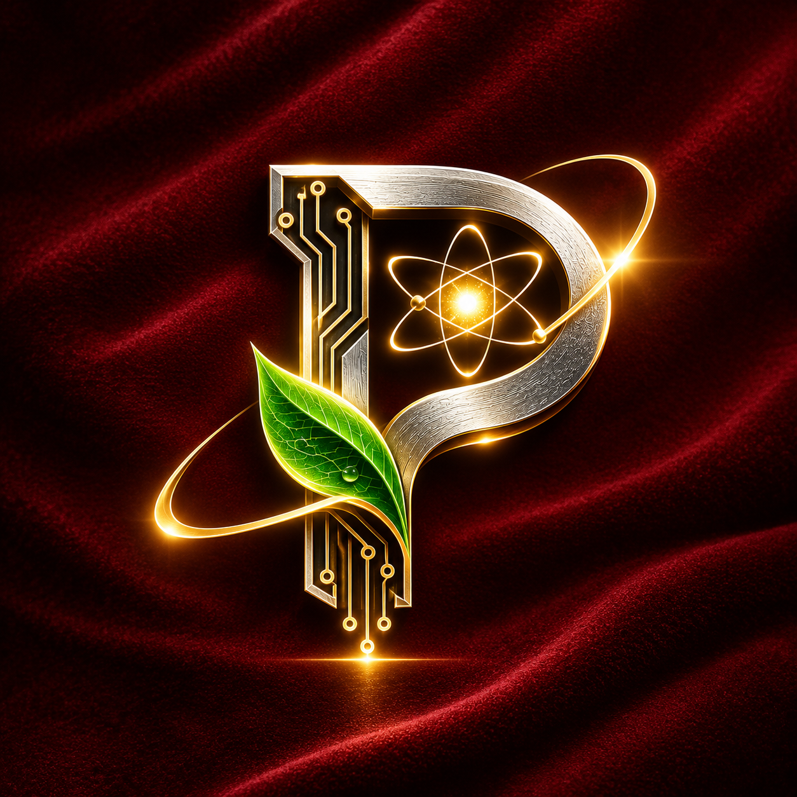

  

# ⚛️ Posithron Protocol
### Beyond energy-wasting Proof-of-Work.

**Posithron** is a next-generation cryptocurrency built on quantum physics principles. It replaces Bitcoin's blind, energy-consuming mining with a symbiotic consensus that **rewards renewable energy production** and **fuels Artificial Intelligence**.

---

## 🌌 The Vision: The End of Blind Computation
Since 2009, the blockchain industry has relied on brute force. Miners wage a zero-sum war, burning gigawatts of electricity to find a meaningless hash. We are entering the Age of Artificial Intelligence, where computation and energy are the twin pillars of civilization. We can no longer afford to waste resources. 

Posithron is a paradigm shift. We replace **Raw Power** with **Quantum Observation**, and **Waste** with **Utility**. The era of destroying the environment for digital security is over; the era of Quantum Symbiosis begins.

---

## 🔀 How It Works: The Dual-Slit Consensus (PoUO)
Inspired by the Quantum Double-Slit Experiment, every node operates in two parallel dimensions:
1.  **Slit A (AI Utility):** Executing useful AI workloads verified by zkML or TEEs.
2.  **Slit B (Renewable Energy):** Contributing green energy to the grid, verified via ZKP smart meters.

Before the QRNG beacon is released, nodes commit to their work. Once the quantum random seed is generated, the network collapses into a single reality, selecting the winning block with absolute unpredictability.

---

## ⚙️ Economic Model & Interference Rewards
Posithron introduces the "Interference Reward" based on the physics of wave interference:
**R = (Alpha * A + Beta * B) + Gamma * 2 * sqrt(A * B) * cos(Phase)**

*   **cos(Phase):** The phase difference. If AI work is executed exactly when renewable energy is peaking, the phase is zero, and the node receives a **maximum interference bonus**.
*   **Entanglement Bonus:** Nodes are randomly paired (AI node + Energy node) to share mutual rewards.
*   **Casimir Reward & Hawking Evaporation:** Built-in mechanisms for network stability and anti-centralization.

---

## 🏗️ Live Testnet Modules (Successfully Implemented & Tested)
We have successfully built and tested the core modules of the Posithron blockchain:
1.  **Cognition (`x/cognition`)**: Manages AI tasks, result submission, and automated bounty payouts.
2.  **GreenEnergy (`x/greenenergy`)**: Records and verifies renewable energy production on-chain.
3.  **Interference (`x/interference`)**: Calculates the quantum wave interference reward formula.
4.  **QRNG (`x/qrng`)**: The Quantum Observer. Generates unpredictable on-chain randomness based on block hashes.
5.  **Entanglement (`x/entanglement`)**: Pairs AI nodes with Energy nodes to share mutual rewards.
6.  **AI Work (`x/aiwork`)**: The foundational module for AI compute tracking.

---

## 📄 Read the Full Whitepaper
For complete mathematical proofs, tokenomics, security simulations, and the roadmap, read our whitepaper here:
👉 **[Read the Posithron Whitepaper](Posithron_whitepaper.md)**

---

> *"Posithron is not an altcoin. It is an evolution. It transforms the blockchain into a decentralized engine for human progress, fueling AI with green energy, and securing the network with the fundamental laws of quantum mechanics."*

**Join the Posithron Revolution.**
